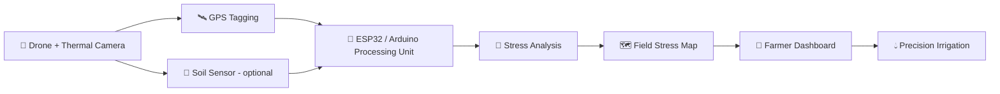

<div align="center">

# 🌿 ThermoFly 🚁

### Smart Crop Water-Stress Detection & Precision Irrigation Monitoring System


**🌱 Healthy Crops &nbsp;|&nbsp; 💧 Efficient Water Use &nbsp;|&nbsp; ♻️ Sustainable Future**

> *Smarter Monitoring. Better Decisions. Healthier Fields.*

</div>

---

## 🔥 The Problem

Farmers lose huge amounts of water and yield because **crop water stress is invisible to the naked eye** until it's too late. Traditional irrigation is guesswork: over-watering wastes resources, under-watering kills yield.

## 💡 The Solution

**ThermoFly** is a drone-based system that flies over a field, captures **thermal images + GPS data**, detects crops under water stress, and delivers a **simple color-coded map** straight to the farmer's phone, so every drop of water goes exactly where it's needed.

---

## ✨ Key Features

| | Feature | Description |
|---|---|---|
| 🌡️ | **Thermal Imaging** | Detects crop water stress through canopy temperature |
| 📍 | **GPS Field Mapping** | Geo-tags every reading for precise location mapping |
| 💧 | **Soil-Moisture Monitoring** | *(Optional)* Ground-truth data for irrigation decisions |
| 📊 | **Visualization Dashboard** | Mobile/web dashboard with maps and analytics |
| 🌾 | **Save Water, Boost Yield** | Targeted irrigation = less waste, healthier crops |

---

## ⚙️ How It Works

```
 ┌──────────────┐     ┌──────────────┐     ┌──────────────┐     ┌──────────────┐
 │ 1. DRONE     │ ──▶ │ 2. DATA      │ ──▶ │ 3. MAPPING   │ ──▶ │ 4. FARMER    │
 │    SURVEY    │     │    ANALYSIS  │     │    & ALERTS  │     │    DASHBOARD │
 └──────────────┘     └──────────────┘     └──────────────┘     └──────────────┘
  Flies over field     Thermal images       GPS tags + sensor    Simple report &
  capturing thermal    processed to find    data create a map    irrigation
  images + GPS data    crop water stress    of problem areas     recommendations
```

1. **🚁 Drone Survey** – The drone flies a planned path over the field, capturing thermal images and GPS data.
2. **🧠 Data Analysis** – Thermal images are processed to identify crop water stress.
3. **🗺️ Mapping & Alerts** – GPS tags and sensor data generate a field map highlighting areas needing attention.
4. **📱 Farmer Dashboard** – The farmer receives an easy-to-read report with irrigation recommendations.

---

## 🎨 Stress Level Legend

| Color | Level | Action |
|:---:|---|---|
| 🔴 | **High Stress** | Irrigate immediately |
| 🟡 | **Moderate** | Monitor closely / schedule irrigation |
| 🟢 | **Healthy** | No action needed |

---

## 🧩 System Components

| Component | Hardware | Role |
|---|---|---|
| 🚁 **Drone Frame & Motors** | Quadcopter + brushless motors | Aerial platform |
| 📷 **Thermal Camera** | FLIR-type | Captures crop temperature imaging |
| 🛰️ **GPS Module** | NEO-6M | Location mapping |
| 🎛️ **Flight Controller** | Ardupilot / Pixhawk | Stabilizes the drone |
| 🌱 **Soil-Moisture Sensor** | Optional | Ground-level moisture data |
| 🔌 **Microcontroller** | ESP32 / Arduino | Collects & processes data |
| 🔋 **Battery & Power Mgmt** | LiPo + PDB | Powers the system |
| 📱 **Mobile / Web Dashboard** | Web app | Data & map visualization |

---

## 🖼️ Sample Output

| RGB Image (Visible) | Thermal Image | Field Map (GPS) | Mobile Dashboard |
|:---:|:---:|:---:|:---:|
| Normal camera view | 🔴 High temp → 🔵 Low temp | Stress zones mapped | Farmer-friendly report |

> 📌 *Add your images to an `/assets` folder and embed them here, e.g. ``*

---

## 🏗️ Architecture



---

## 🚀 Getting Started

```bash
# Clone the repository
git clone https://github.com/<your-username>/thermofly.git
cd thermofly

# Install dependencies
pip install -r requirements.txt

# Run the analysis pipeline on sample data
python analyze.py --input data/sample_thermal.jpg
```

> ⚠️ *This is a conceptual prototype. Code and hardware integration are under development.*

---

## 🗺️ Roadmap

- [x] Concept design & system architecture
- [ ] Thermal image processing pipeline
- [ ] GPS-tagged stress map generation
- [ ] Web / mobile dashboard
- [ ] Soil-moisture sensor integration
- [ ] Autonomous flight path planning
- [ ] Field testing & calibration
- [ ] ML-based stress classification

---

## 🌍 Impact

- 💧 **Saves water** through targeted irrigation
- 🌾 **Improves crop yield** by catching stress early
- 💰 **Cuts costs** for farmers
- ♻️ **Promotes sustainable farming**

---

## 🛠️ Tech Stack

`Python` · `OpenCV` · `NumPy` · `ArduPilot` · `Pixhawk` · `ESP32` · `Arduino` · `React / Web Dashboard` · `GPS (NEO-6M)` · `FLIR Thermal`

---

## 🤝 Contributing

Contributions, ideas, and feedback are welcome!

1. Fork the repo
2. Create your branch: `git checkout -b feature/awesome-feature`
3. Commit your changes: `git commit -m "Add awesome feature"`
4. Push and open a Pull Request

---

## 📄 License

Distributed under the MIT License. See `LICENSE` for details.

---

<div align="center">

### 🌿 ThermoFly: *Smarter Monitoring. Better Decisions. Healthier Fields.* 🌿

⭐ **Star this repo if you believe in smarter farming!** ⭐

</div>
